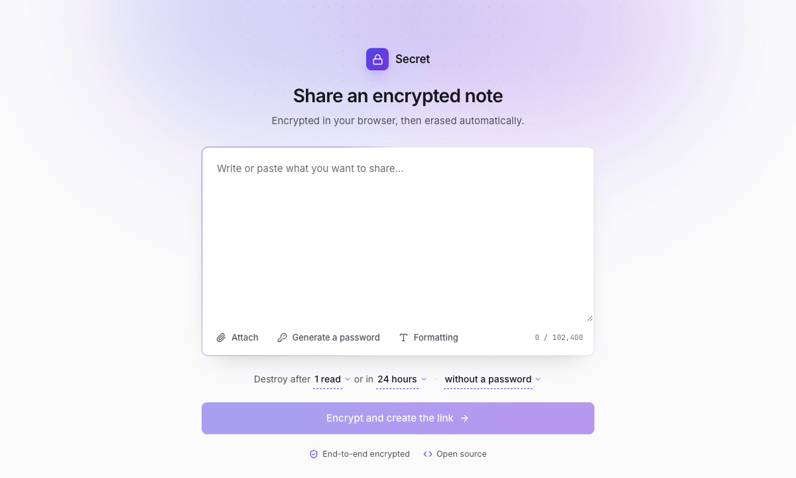
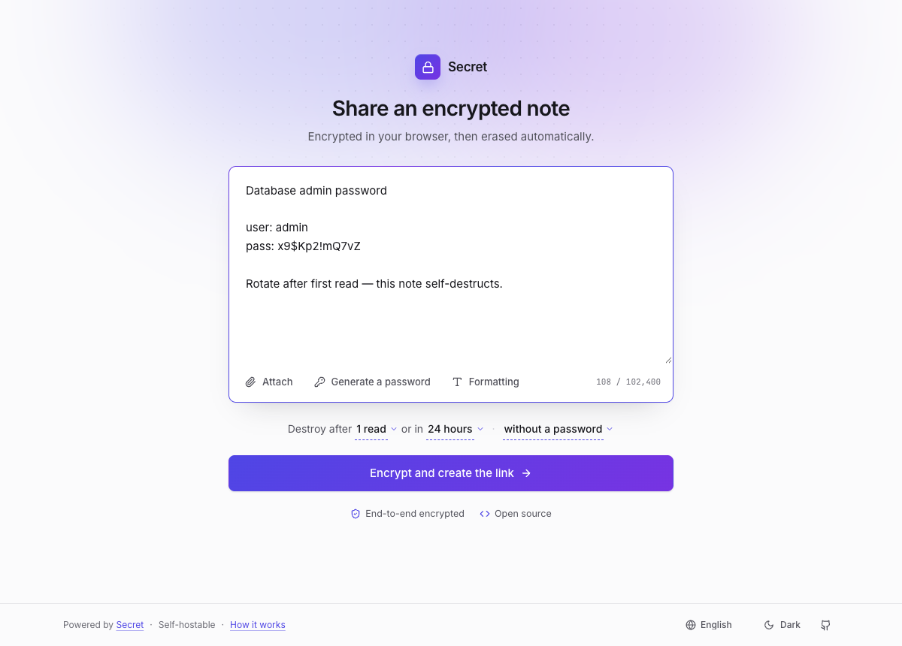
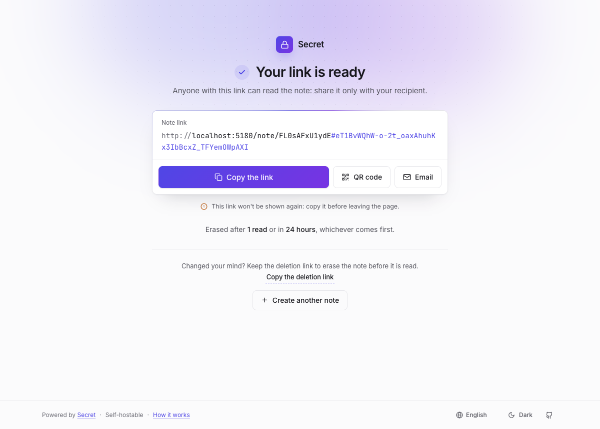
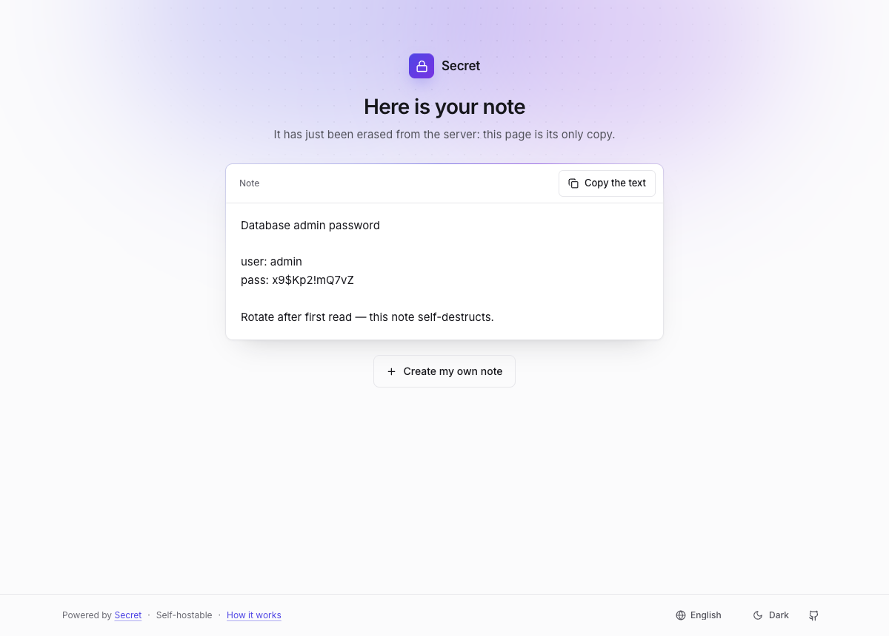

<p align="center">
  
</p>

<h1 align="center">Secret</h1>

<p align="center"><b>Share an encrypted note that opens only once.</b></p>

<p align="center">
  <a href="https://github.com/largerio/secret/actions/workflows/deploy.yml"></a>
  <a href="vitest.config.ts"></a>
  <a href="LICENSE"></a>
  <a href="https://github.com/largerio/secret/stargazers"></a>
  <a href="https://www.typescriptlang.org/"></a>
  <a href="https://ghcr.io/largerio/secret"></a>
  <a href="https://www.npmjs.com/package/@largerio/secret-sdk"></a>
  <a href="https://www.npmjs.com/package/@largerio/secret-cli"></a>
</p>

<p align="center">
  <a href="https://secret.larger.io"><b>Live demo</b></a> &nbsp;·&nbsp;
  <a href="#quick-start">Quick start</a> &nbsp;·&nbsp;
  <a href="docs/self-hosting.md">Self-hosting</a> &nbsp;·&nbsp;
  <a href="#sdk">SDK</a> &nbsp;·&nbsp;
  <a href="#command-line">CLI</a> &nbsp;·&nbsp;
  <a href="SECURITY.md">Security</a>
</p>

Type a password or a message, or drop a file: it's encrypted in your browser,
and you get a link that works once. The server never sees what you send.

Secret runs in a single Docker container you host yourself. There are no
accounts and no analytics, and the logs hold no content, keys or IP
addresses. It's an open-source alternative to PrivateBin, OneTimeSecret and
Yopass, built with Svelte 5, Hono and TypeScript.

<p align="center">
  
</p>

<p align="center">
  <picture>
    <source media="(prefers-color-scheme: dark)" srcset="docs/images/create-dark.png" />
    
  </picture>
  &nbsp;
  <picture>
    <source media="(prefers-color-scheme: dark)" srcset="docs/images/share-dark.png" />
    
  </picture>
  &nbsp;
  <picture>
    <source media="(prefers-color-scheme: dark)" srcset="docs/images/view-dark.png" />
    
  </picture>
</p>

<p align="center"><sub><b>Create</b>: encrypted locally &nbsp;·&nbsp; <b>Share</b>: a one-time link, the key never sent &nbsp;·&nbsp; <b>Read</b>: decrypted in the browser, then gone</sub></p>

## Features

- End-to-end encryption with XChaCha20-Poly1305 in the browser, plus an
  AES-256-GCM layer on the server.
- Text and files: up to 10 files and 500 MB per note, with drag and drop.
  Files are encrypted and uploaded in chunks, and decrypted straight to disk,
  so a large file never sits in memory.
- Burn after reading, or after a set number of reads, and an expiry from 5
  minutes to 30 days.
- An optional password, stretched with Argon2id. The server checks a proof of
  the password before serving anything: a wrong one spends no read, and the
  fifth deletes the note.
- Padding to a size class, 4 KiB at least, so the server doesn't learn how
  long a note is.
- A delete link, to remove a note before anyone reads it.
- Markdown with a preview (sanitized with DOMPurify), a password generator,
  and previews of images, video and audio once decrypted.
- QR codes, light and dark themes, and 10 languages (en, fr, es, de, pt, it,
  ja, zh, ru, ko). [Adding one](CONTRIBUTING.md#adding-a-language) takes a
  JSON file in [`messages/`](messages/) and four registrations.
- A [JS/TS SDK](packages/sdk-js/README.md) and a
  [command line](packages/cli/README.md), `secret send` and `secret read`.
- Files on the data volume or in any S3-compatible bucket (AWS S3,
  Cloudflare R2, RustFS, Garage), and your own name, accent color and footer.

## Comparison

| Feature                | Secret              | PrivateBin          | OneTimeSecret       | Yopass              |
|------------------------|---------------------|---------------------|---------------------|---------------------|
| Zero-knowledge         | Yes                 | Yes                 | No (server-side)    | Yes                 |
| Client cipher          | XChaCha20-Poly1305  | AES-256-GCM         | —                   | OpenPGP             |
| Encryption at rest     | Yes (AES-256-GCM)¹  | No                  | Yes                 | No                  |
| File attachments       | Up to 10, 500 MB    | Single, opt-in      | No                  | Single, streaming   |
| File previews          | Image/AV            | Image/PDF/media     | No                  | No                  |
| Burn after read        | Yes                 | Yes                 | Yes                 | Yes (toggleable)    |
| Read limits (N reads)  | Yes                 | No                  | No                  | No                  |
| Password protection    | Yes (Argon2id)      | Yes (PBKDF2)        | Yes (passphrase)    | Yes                 |
| Official SDK           | Yes (JS/TS) + CLI   | No                  | REST API only       | CLI only            |
| Stack                  | Svelte 5 + Hono     | PHP                 | Ruby                | Go + React          |
| Deploy                 | Single Docker       | PHP server          | Ruby + Redis        | Single Docker       |

¹ A server-held key, on top of the end-to-end layer. On its own it protects a
leaked database or S3 bucket, not a stolen data volume when the key is stored
on that volume, which is the default. See
[what the server can see](SECURITY.md#what-the-server-can-see).

The comparison reflects each project's public documentation when it was
written. Check their docs for the latest.

## Quick start

With Docker, there's nothing to clone or build:

```bash
mkdir secret && cd secret
curl -O https://raw.githubusercontent.com/largerio/secret/main/docker-compose.yml
docker compose up -d
```

Open `http://localhost:3000`. The server's encryption key is generated on
the first launch and saved in the data volume, so there's nothing to
configure. The API reference is at `/api/v1/docs`.

To serve it on your own domain over HTTPS, add `docker-compose.tls.yml`. It
runs Caddy, which gets and renews the certificate. Point the domain at the
host first:

```bash
curl -O https://raw.githubusercontent.com/largerio/secret/main/docker-compose.tls.yml
echo "DOMAIN=secret.example.com" > .env
docker compose -f docker-compose.yml -f docker-compose.tls.yml up -d
```

The [self-hosting guide](docs/self-hosting.md) covers the rest: settings, a
reverse proxy you already run, Synology, Coolify, Portainer and Render,
backups, monitoring and updates. If something goes wrong, start with
`docker compose logs -f` and [Troubleshooting](docs/self-hosting.md#troubleshooting).

[](https://render.com/deploy?repo=https://github.com/largerio/secret)

## SDK

Create and read notes from your own code, on any Secret instance:

```bash
npm install @largerio/secret-sdk
```

```typescript
import { SecretClient } from "@largerio/secret-sdk";

const client = await SecretClient.create({
  baseUrl: "https://secret.example.com",
  apiKey: "your-api-key",
});

// Create a note
const { id, keyFragment } = await client.createNote({ text: "Hello, World!" });
const shareUrl = client.buildShareUrl(id, keyFragment);

// Read a note from a share URL
const parsed = SecretClient.parseShareUrl(shareUrl);
const { payload } = await client.readNote(parsed.id, parsed.keyFragment);
console.log(payload.text); // "Hello, World!"
```

Reading is open. Writing needs an API key from the instance's operator, or a
proof of work: see the [SDK's README](packages/sdk-js/README.md).

## Command line

Send and read notes from a terminal or a script, on any instance (Node.js 22
or later):

```bash
npm install -g @largerio/secret-cli

echo "the launch code is 0000" | secret send --instance https://secret.example.com
secret read          # asks for the link, without echo
```

To write, it takes an API key in `SECRET_API_KEY`, or solves the instance's
proof of work as the browser does. See the
[CLI's README](packages/cli/README.md).

## How it works

```
Browser                                   Server
┌──────────────────────┐             ┌──────────────────┐
│ 1. Generate key      │             │                  │
│ 2. Encrypt (XChaCha) │──ciphertext►│ 3. Encrypt (AES) │
│                      │             │ 4. Store         │
│ URL: /note/id#key    │             │                  │
│        └─ never sent │             │ Never sees key   │
└──────────────────────┘             └──────────────────┘
```

The key lives in the URL fragment (`#key`), which browsers never send to the
server. Opening a note works the other way round: the browser proves it holds
the link, the server sends the ciphertext, and the browser decrypts it.

[PROTOCOL.md](PROTOCOL.md) specifies the format and the API, with test
vectors, for anyone writing a client in another language.

## Security

- The server stores ciphertext it can't read, and only serves it to a reader
  who proves they hold the link.
- The code that encrypts comes from the server, though. The web app is a
  reproducible build: each release publishes its digest, which every
  instance reports, so anyone can [check](SECURITY.md#verifying-the-web-app)
  what an instance serves them.
- The images are signed, with a build provenance attestation
  ([how to verify](docs/self-hosting.md#verifying-the-image)).
- A strict Content Security Policy, a non-root container on a read-only
  filesystem, and per-IP rate limits.

[SECURITY.md](SECURITY.md) covers the threat model, what the server can and
can't see, the known limitations, and how to report a vulnerability.

## Contributing

[CONTRIBUTING.md](CONTRIBUTING.md) explains how to set up the project, run
the tests and send a change.

## License

[MIT](LICENSE)
